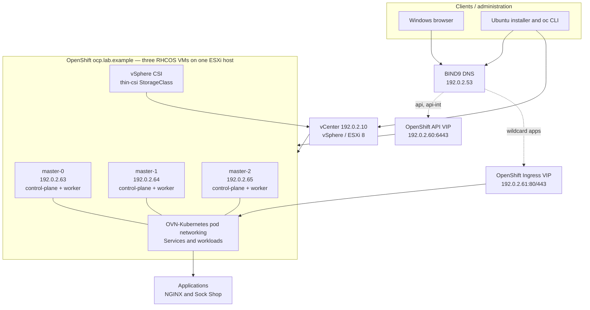

# High-Level Design (HLD)
## Red Hat OpenShift on VMware vSphere — Compact Three-Node Lab

> **Public portfolio note:** Hostnames, IP addresses, network names and infrastructure labels in this repository are intentionally anonymized. Documentation uses RFC 5737 TEST-NET address space and the reserved `.example` domain; these values do not represent the underlying environment.

**Document status:** As-built lab design, with proposed enterprise extensions clearly separated  
**Version:** 1.0 | **Date:** 21 October 2026  
**Environment:** Home lab | **Cluster:** `ocp.lab.example`  
**Audience:** Platform engineers, virtualization engineers, SREs, architecture and interview reviewers

## 1. Executive summary

This design documents a self-managed Red Hat OpenShift Container Platform installation on VMware vSphere 8 using installer-provisioned infrastructure (IPI). The observed cluster version is **OpenShift 4.22.18**, running Kubernetes **v1.35.8**. The **three RHCOS control-plane VMs also schedule application workloads**; there are **zero dedicated worker VMs** in the as-built environment. All three VMs reside on a single ESXi physical host and therefore this is **not a physically highly available platform**.

The cluster exposes its Kubernetes API and application ingress through virtual IP addresses (VIPs). DNS is provided by an Ubuntu BIND9 instance, with an OVN-Kubernetes pod network. vSphere CSI presents the default `thin-csi` StorageClass. An NGINX app and the **13-deployment Sock Shop microservices demonstration** were deployed successfully. Sock Shop was made compatible with restricted OpenShift security by adjusting application ports and addressing legacy executable file capabilities.

## 2. Design objectives and scope

**Objectives**
- Deploy a functioning self-managed OpenShift environment on existing VMware infrastructure.
- Operate the same Kubernetes/OpenShift interfaces used for production application deployments.
- Provide DNS resolution for API, console and wildcard application routes.
- Support multiple stateless applications and their supporting databases/broker.
- Practice image security, Deployments/ReplicaSets/Services/Routes, troubleshooting and CSI provisioning.

**In scope:** vSphere IPI provisioning; three schedulable control-plane nodes; RHCOS; local DNS; API/Ingress VIPs; ingress and service exposure; vSphere CSI; image-registry setup exercise; NGINX and Sock Shop demonstrations.

**Out of scope:** production HA across ESXi hosts/sites, backup/restore testing, formal disaster recovery, GitOps/CI/CD, corporate PKI, monitoring SLOs, production hardening, external dedicated load balancer, AD-integrated DNS and DHCP, and three dedicated workers.

## 3. Logical architecture

**Note:** The diagram is logical; it does not imply independently resilient API/Ingress load balancers. Exact VIP implementation is installer-controlled and should be verified on the cluster.

## 4. Infrastructure architecture

| Layer | As-built design | Rationale / limitation |
|---|---|---|
| Hypervisor | VMware ESXi 8 under vCenter, datacenter `LAB-DC`, cluster `LAB-CLUSTER` | Reuses the home-lab platform |
| Physical availability | One available ESXi physical host for the OpenShift VMs | A host outage affects the whole OpenShift cluster |
| Nodes | 3 × RHCOS master VMs, schedulable for workloads | Compact installation; no dedicated workers |
| Provisioning | vSphere installer-provisioned infrastructure (IPI) | Automatic VM/bootstrapping and cluster configuration |
| Virtual network | `LAB-NET`, `192.0.2.0/24` | Existing home LAN |
| DNS | Ubuntu BIND9 on `192.0.2.53` | Authoritative cluster records and external forwarding |
| Control-plane access | API VIP `192.0.2.60` | Consistent API endpoint |
| App access | Ingress VIP `192.0.2.61` | Wildcard OpenShift Routes |
| Pod network | OVN-Kubernetes | CNI observed in actual Pod annotations |
| CSI | VMware vSphere CSI, default `thin-csi` | Kubernetes PVC integration with vSphere storage policies |
| Storage | VMFS datastore `datastore1 (1)` with thin virtual disks | Avoids exhaustion encountered with thick provisioning |
| TLS | Lab/default ingress certificate | Trust warning observed; production PKI not configured |

## 5. Workload architecture

### NGINX
- Deployed in project `demo` using a Kubernetes Deployment and ReplicaSet.
- Uses `nginxinc/nginx-unprivileged:stable` to satisfy non-root execution restrictions.
- Application listens on **8080**. Service can expose **80** with `targetPort: 8080`; OpenShift Route connects clients through ingress.
- Validated through an HTTP 200 response and NGINX response header.

### Sock Shop microservices

For deployment sequence, fixes and validation evidence, see the [Sock Shop deployment runbook](Sock_Shop_Deployment_Runbook.md).
- Deployed to namespace `sock-shop` from the OpenShift-adapted Sock Shop demo manifests.
- **13 Deployments**: `carts`, `carts-db`, `catalogue`, `catalogue-db`, `front-end`, `orders`, `orders-db`, `payment`, `queue-master`, `rabbitmq`, `shipping`, `user`, `user-db`.
- The user confirmed all deployments running after resolving initial failures. End-to-end checkout behavior was **not independently verified**.
- Java services were moved from privileged port 80 to 8080 using `SERVER_PORT=8080`, where supported; Services target 8080.
- Legacy Go executables in `catalogue`, `payment` and `user` carried `cap_net_bind_service=ep`, incompatible with restricted container execution. As a **lab workaround**, the entrypoint copies the binary to `/tmp` (dropping file capabilities on the copied file) and invokes it with `-port=8080`; the Service targets 8080.
- Rebuilding compliant images is the preferred production design.

## 6. Security architecture

- OpenShift security policies apply restricted execution. The examined `catalogue` Pod used **`restricted-v2`**, `RuntimeDefault` seccomp and a non-root UID.
- Avoid blanket `anyuid` or `privileged` SCC grants. A temporary `Unconfined` seccomp diagnostic was rejected by the active security policy and later reverted.
- API kubeconfig, kubeadmin password, Red Hat pull secret, vCenter credentials and installer state are sensitive and must not enter Git repositories.
- Prefer vCenter least-privilege service accounts, trusted enterprise CA/ingress certificates, RBAC and sealed/externalized secrets for production.

## 7. Availability and capacity

This cluster has three etcd/control-plane nodes, but they share one physical host and datastore. It is suitable for hands-on learning; it is **not equivalent to a production HA topology**. The installer completed in ~39m43s after configuring thin disks. An initial thick-provisioned attempt reduced free datastore capacity from approximately 563 GB to 2.83 GB and was destroyed/redeployed. Per-node sizing targeted **4 vCPU, 16 GiB RAM, 100 GB OS disk**; actual vCenter allocations should be cross-checked.

The internal registry initially had `managementState: Removed`. A **100 GiB RWO PVC using `thin-csi`** and single-replica registry were configured as an exercise; final registry PVC-bound/ready status was not recorded, so this document does not claim a fully validated internal registry.

## 8. Operational model

**Day-2 checks:** node readiness; cluster operators and cluster version; pod restarts; routes and endpoint ports; datastore free space; CSI volume state; DNS records and API/Ingress VIP availability.

**Known troubleshooting lessons:**
- Trusting the verified vCenter CA resolved installer TLS errors.
- Proper BIND9 forwarding and Ubuntu DNS routing resolved RHCOS mirror hostname failures.
- Thin provisioning resolved datastore capacity pressure.
- OpenShift ImageStream triggers can overwrite a manually changed Deployment image.
- `Running` Pods do not imply correct Service targetPorts or usable Routes.
- Old application binaries with embedded file capabilities can fail under `restricted-v2` with `Operation not permitted`.

## 9. Enterprise six-node extension (proposed, NOT deployed)

For an enterprise target, propose **3 dedicated control-plane VMs + 3 dedicated worker VMs**, spread across multiple ESXi physical hosts and suitable failure domains; AD-integrated DNS backed by at least two resolvers; enterprise DHCP/IPAM for appropriate reserved network assignments; a supported resilient API/Ingress VIP implementation; shared resilient storage; production ingress certificates; tested backups/restore; observability; and controlled image build pipelines. The six-node design is **conceptual only** and must not be represented as the completed three-node lab.

## 10. Acceptance criteria and evidence

| Criterion | Evidence / status |
|---|---|
| Three nodes Ready | Observed via `oc get nodes` — passed |
| Core operators healthy | Console, ingress, authentication reported Available=True — passed |
| API and console DNS | BIND9 records and console curl HTTP 200 — passed |
| NGINX Route | HTTP 200 observed — passed |
| Sock Shop 13 deployments running | Confirmed by user — passed at workload status level |
| Sock Shop end-to-end purchase | Not recorded — pending functional test |
| Registry PVC bound and ready | Not recorded — verify |
| Multi-host HA/failover | Not applicable — single-host lab |
