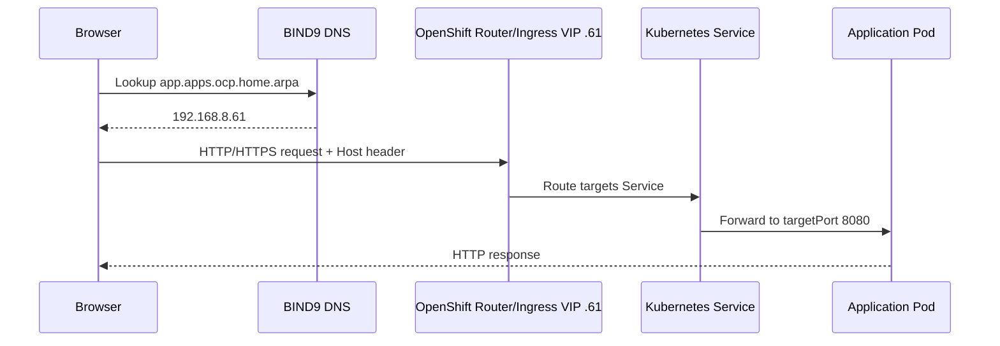

# Low-Level Design (LLD)
## OpenShift on VMware vSphere — As-Built Implementation and Configuration

**Document status:** As-built lab and validation guide  
**Version:** 1.0 | **Date:** 21 October 2026  
**Scope:** Three-node compact OpenShift installation (not the conceptual six-node enterprise extension)

## 1. Infrastructure inventory and addressing

| Item | Configured / observed |
|---|---|
| vCenter | `192.168.8.221` |
| vSphere datacenter | `Homelab-DC` |
| vSphere compute cluster | `HomeLab-Cluster` |
| Datastore | `datastore1 (1)` |
| Port group | `VM Network` |
| Management/application VLAN subnet | `192.168.8.0/24` |
| Default gateway | `192.168.8.1` |
| DNS resolver | `192.168.8.214` (Ubuntu BIND9) |
| DNS/installer VM | `nfs-server` with `ens33=192.168.8.214/24` and `ens34=10.10.10.10/24` |
| Base domain | `home.arpa` |
| Cluster | `ocp.home.arpa` |
| API VIP | `192.168.8.60` |
| Ingress VIP | `192.168.8.61` |
| Bootstrap (ephemeral) | `192.168.8.62` |
| Control-plane/master 0 | `192.168.8.63` |
| Control-plane/master 1 | `192.168.8.64` |
| Control-plane/master 2 | `192.168.8.65` |
| Dedicated worker nodes | **0** |
| RHCOS master VM sizing target | **4 vCPU, 16 GiB RAM, 100 GB OS disk** (verify against vCenter actual) |
| OpenShift observed | **4.22.18**, Kubernetes **v1.35.8** |
| Storage driver | `csi.vsphere.vmware.com` |
| StorageClass | `thin-csi` (default), `WaitForFirstConsumer` |
| CSI vSphere storage policy | `openshift-storage-policy-ocp-76lch` |
| Pod network | OVN-Kubernetes (pod IPs in 10.128.x–10.130.x ranges observed, complete CIDR not recorded) |
| Cluster service CIDR | Not recorded; examples of service ClusterIPs in 172.30.x.x range only |
| Infrastructure-specific VIP implementation | Installer-managed; verify actual resources prior to formal handover |

**Never use this list as a substitute for checking actual configured resources.** Values come from the hands-on lab walkthrough; several items (e.g. CPU/RAM actuals, network CIDR, registry readiness) require verification.

## 2. DNS configuration

DNS zone: `ocp.home.arpa` on BIND9 `192.168.8.214`.

| FQDN | Type | Target | Role |
|---|---|---|---|
| `api.ocp.home.arpa` | A | `192.168.8.60` | External Kubernetes API |
| `api-int.ocp.home.arpa` | A | `192.168.8.60` | Internal API |
| `*.apps.ocp.home.arpa` | Wildcard A | `192.168.8.61` | OpenShift ingress Routes |
| `console-openshift-console.apps.ocp.home.arpa` | Wildcard resolution | `192.168.8.61` | Console |
| `oauth-openshift.apps.ocp.home.arpa` | Wildcard resolution | `192.168.8.61` | Login |

BIND9 example `/etc/bind/named.conf.local`:

```conf
zone "ocp.home.arpa" {
  type master;
  file "/etc/bind/db.ocp.home.arpa";
};
```

Zone example `/etc/bind/db.ocp.home.arpa`:

```dns
$TTL 300
@ IN SOA ns1.ocp.home.arpa. admin.ocp.home.arpa. (
  2026101901 3600 900 604800 300
)
@       IN NS ns1.ocp.home.arpa.
ns1     IN A 192.168.8.214
api     IN A 192.168.8.60
api-int IN A 192.168.8.60
*.apps  IN A 192.168.8.61
```

Upstream recursion/forwarding was configured to `192.168.8.1` and `1.1.1.1` (`forward only`). Validate your BIND9 ACLs and firewall if reused.

```bash
sudo named-checkconf
sudo named-checkzone ocp.home.arpa /etc/bind/db.ocp.home.arpa
sudo systemctl restart named
dig @192.168.8.214 api.ocp.home.arpa +short
dig @192.168.8.214 test.apps.ocp.home.arpa +short
dig @192.168.8.214 rhcos.mirror.openshift.com +short
```

During installation, Ubuntu's `systemd-resolved` sometimes failed to route public DNS queries. Temporary fix (interface `ens33`):

```bash
sudo resolvectl dns ens33 192.168.8.214
sudo resolvectl domain ens33 '~.'
sudo resolvectl default-route ens33 yes
resolvectl query rhcos.mirror.openshift.com
```

Persist through your Ubuntu network configuration if required. Windows users must point to DNS that hosts/forwards this zone, or temporarily add individual Route hostnames in the hosts file. A hosts file **does not support wildcard DNS entries**.

## 3. vCenter/ESXi and storage preparation

1. Check ESXi/vCenter reachability, datastore capacity, VM Network port group, and vCenter permission scope.
2. Download the verified vCenter CA certificate from the vCenter `https://<vcenter>/certs/download.zip` endpoint and add the appropriate trusted certificate to the installer host's OS trust store. Certificate hostname SAN must match the vCenter name/IP used by installer.
3. Reserve `.60` through `.65` as planned and ensure no DHCP conflict.
4. Choose thin disks: our first thick-provisioned install nearly exhausted the VMFS datastore (approximately 563 GB down to 2.83 GB free).
5. Ensure installer host and provisioned VMs can resolve external registries and cluster names.

No vSphere license, exact ESXi build for this OpenShift cluster or final raw datastore capacity snapshot was recorded in the walkthrough.

## 4. Installer configuration and deployment

Install the correct `openshift-install` and `oc` binaries from Red Hat. The installer selects the corresponding RHCOS VMware image. **Do not mix arbitrary release binaries or RHCOS OVAs.**

```bash
./openshift-install version
oc version --client
mkdir -p ~/ocp420
./openshift-install create install-config --dir ~/ocp420
```

Select the actual vCenter, datacenter, cluster, datastore, port group, base domain, API/Ingress VIPs, pull secret and SSH key. Example **partial** config (keep all generated vSphere details):

```yaml
compute:
- name: worker
  replicas: 0
  platform: {}
controlPlane:
  name: master
  replicas: 3
  platform:
    vsphere:
      osDisk:
        diskSizeGB: 100
platform:
  vsphere:
    diskType: thin
    apiVIPs: [192.168.8.60]
    ingressVIPs: [192.168.8.61]
    hosts:
    - role: bootstrap
      networkDevice:
        ipAddrs: [192.168.8.62/24]
        gateway: 192.168.8.1
        nameservers: [192.168.8.214]
    - role: control-plane
      networkDevice:
        ipAddrs: [192.168.8.63/24]
        gateway: 192.168.8.1
        nameservers: [192.168.8.214]
    - role: control-plane
      networkDevice:
        ipAddrs: [192.168.8.64/24]
        gateway: 192.168.8.1
        nameservers: [192.168.8.214]
    - role: control-plane
      networkDevice:
        ipAddrs: [192.168.8.65/24]
        gateway: 192.168.8.1
        nameservers: [192.168.8.214]
```

The above is **not** valid standalone install-config; vSphere generated configuration, credentials and pull-secret information are omitted intentionally.

The `osDisk` field initially failed when placed under root `platform.vsphere`; moving it to `controlPlane.platform.vsphere.osDisk` was accepted in the tested installer. Protect your config:

```bash
cp ~/ocp420/install-config.yaml ~/ocp-install-config.private.yaml
chmod 600 ~/ocp-install-config.private.yaml
./openshift-install create cluster --dir ~/ocp420 --log-level=info
```

The successful run lasted **39 minutes 43 seconds**. Installer automatically created/removed temporary bootstrap infrastructure and provisioned three schedulable RHCOS masters.

Validation:

```bash
export KUBECONFIG=/home/nfsadmin/ocp420/auth/kubeconfig
oc get nodes -o wide
oc get co
oc get clusterversion
oc get infrastructure cluster -o yaml
```

Observed nodes:

```text
ocp-76lch-master-0  Ready  control-plane,master,worker  v1.35.8
ocp-76lch-master-1  Ready  control-plane,master,worker  v1.35.8
ocp-76lch-master-2  Ready  control-plane,master,worker  v1.35.8
```

The authentication, ingress and console cluster operators reported `Available=True`, `Progressing=False`, `Degraded=False` and version `4.22.18`.

**Destruction:** `./openshift-install destroy cluster --dir ~/ocp420` is destructive and should be used only after confirming the target and retaining valid installer state.

## 5. Ingress and application traffic flow



OpenShift Services can expose port 80 while the application process runs on 8080. **The Service port, targetPort, and real process listener are separate concepts**. Creating a Service alone does **not** create a Route.

Useful checks:

```bash
oc get ingresscontroller -n openshift-ingress-operator
oc get route -A
oc get service -A
oc get endpoints -n demo
nslookup api.ocp.home.arpa 192.168.8.214
```

## 6. Storage and image registry

Observed default StorageClass:

```text
thin-csi (default)   csi.vsphere.vmware.com   Delete   WaitForFirstConsumer
```

Storage policy parameter: `openshift-storage-policy-ocp-76lch`. The registry initially was configured with `managementState: Removed`, which prevented build output to an integrated ImageStream.

Registry PVC example used in the exercise:

```yaml
apiVersion: v1
kind: PersistentVolumeClaim
metadata:
  name: image-registry-storage
  namespace: openshift-image-registry
spec:
  accessModes: [ReadWriteOnce]
  volumeMode: Filesystem
  storageClassName: thin-csi
  resources:
    requests:
      storage: 100Gi
```

Operator configuration for a **single-replica lab registry**:

```bash
oc apply -f registry-pvc.yaml
oc patch configs.imageregistry.operator.openshift.io cluster --type=merge \
  -p '{"spec":{"managementState":"Managed","replicas":1,"rolloutStrategy":"Recreate","storage":{"pvc":{"claim":"image-registry-storage"}}}}'
oc get pvc,pods -n openshift-image-registry
oc get co image-registry
```

Status caveat: the walkthrough did **not capture conclusive Ready/Bound confirmation** after this step. Treat registry completion as needing verification. A single RWO replica is not a production HA registry design.

## 7. NGINX Deployment (project demo)

**Container:** `nginxinc/nginx-unprivileged:stable` (a `nginx/1.30.6` Server response was observed). **Listening port:** 8080. **Service port:** 80. **Route:** under `*.apps.ocp.home.arpa`.

A reproducible, sanitized specification:

```yaml
apiVersion: apps/v1
kind: Deployment
metadata:
  name: demo-pod
  namespace: demo
spec:
  replicas: 1
  selector:
    matchLabels:
      deployment: demo-pod
  template:
    metadata:
      labels:
        deployment: demo-pod
    spec:
      containers:
      - name: nginx
        image: nginxinc/nginx-unprivileged:stable
        ports:
        - containerPort: 8080
---
apiVersion: v1
kind: Service
metadata:
  name: nginx-svc
  namespace: demo
spec:
  selector:
    deployment: demo-pod
  ports:
  - port: 80
    targetPort: 8080
```

```bash
oc create namespace demo --dry-run=client -o yaml | oc apply -f -
oc apply -f nginx.yaml
oc expose svc/nginx-svc --name=nginx-route -n demo
oc rollout status deployment/demo-pod -n demo
curl -I "http://$(oc get route nginx-route -n demo -o jsonpath='{.spec.host}')"
```

The original standard `nginx` image failed writing `/var/cache/nginx/client_temp` under OpenShift non-root execution. The original ImageStream trigger for `nginx:1.24` also reverted manual image changes; removing unnecessary Deployment annotation `image.openshift.io/triggers` prevented this. A separate NGINX Service with two replicas also required `targetPort: 8080` before browser access worked.

## 8. Sock Shop: deployed resource inventory

Namespace: `sock-shop`. The application was deployed from the [OpenShift-adapted Sock Shop repository](https://github.com/mosuke5/microservices-demo-openshift) (`complete-demo.yaml`). The running result was confirmed by the user after fixes, but no end-to-end transaction trace has been recorded.

| Deployment | Function | Outcome | Fix, if applied |
|---|---|---|---|
| carts | Cart API | Running | `SERVER_PORT=8080`, Service targetPort 8080 |
| carts-db | Cart MongoDB | Running | None needed |
| catalogue | Catalogue API | Running | Copy `/app` to `/tmp`, exec with `-port=8080`; Service 8080 |
| catalogue-db | Catalogue MySQL | Running | None needed |
| front-end | Web UI | Running | None needed |
| orders | Orders API | Running | `SERVER_PORT=8080`, Service 8080 |
| orders-db | Orders MongoDB | Running | None needed |
| payment | Payment API | Running | Copy `/app` to `/tmp`, exec with `-port=8080`; Service 8080 |
| queue-master | Message processing | Running | `SERVER_PORT=8080`, Service 8080 |
| rabbitmq | Message broker | Running | None needed |
| shipping | Shipping API | Running | `SERVER_PORT=8080`, Service 8080 |
| user | User API | Running | Copy `/user` to `/tmp`, exec with `-port=8080`; Service 8080 |
| user-db | User MongoDB | Running | None needed |

**Why Go executables failed:** debug inspection of `/app` and `/user` showed `cap_net_bind_service+ep`, but process capability bounding sets were empty and `NoNewPrivs: 1` under restricted execution. Executing the original returned `Operation not permitted`. Copying to `/tmp` removed file capabilities and allowed execution; starting the copy with `-port=8080` succeeded. The same flags were validated individually in temporary debug pods for `catalogue`, `payment` and `user`.

### Representative commands used

Java/Spring Boot applications (where confirmed to support `SERVER_PORT`):

```bash
for app in carts orders queue-master shipping; do
  oc set env deployment/$app SERVER_PORT=8080 -n sock-shop
  oc patch svc "$app" -n sock-shop --type=merge \
    -p '{"spec":{"ports":[{"port":80,"targetPort":8080,"protocol":"TCP"}]}}'
done
```

Go executables — catalogue example (the lab workaround):

```bash
oc patch deployment catalogue -n sock-shop --type=strategic \
  -p '{"spec":{"template":{"spec":{"containers":[{"name":"catalogue","command":["/bin/sh","-c"],"args":["cp /app /tmp/app-test && exec /tmp/app-test -port=8080"]}]}}}}'
oc patch svc catalogue -n sock-shop --type=merge \
  -p '{"spec":{"ports":[{"port":80,"targetPort":8080,"protocol":"TCP"}]}}'
```

Payment and user equivalent workarounds:

```bash
oc patch deployment payment -n sock-shop --type=strategic \
  -p '{"spec":{"template":{"spec":{"containers":[{"name":"payment","command":["/bin/sh","-c"],"args":["cp /app /tmp/app-test && exec /tmp/app-test -port=8080"]}]}}}}'
oc patch svc payment -n sock-shop --type=merge \
  -p '{"spec":{"ports":[{"port":80,"targetPort":8080,"protocol":"TCP"}]}}'
oc patch deployment user -n sock-shop --type=strategic \
  -p '{"spec":{"template":{"spec":{"containers":[{"name":"user","command":["/bin/sh","-c"],"args":["cp /user /tmp/user-test && exec /tmp/user-test -port=8080"]}]}}}}'
oc patch svc user -n sock-shop --type=merge \
  -p '{"spec":{"ports":[{"port":80,"targetPort":8080,"protocol":"TCP"}]}}'
```

**Caution:** Those startup-copy commands are **temporary lab workarounds**. Rebuild the images with unprivileged listeners and without unnecessary binary file capabilities for maintainable deployments. Do not grant anyuid/privileged SCC globally. The legacy manifest contains old credentials/defaults; never treat them as secure for production use.

The `front-end` Route can be created with:

```bash
oc expose service/front-end -n sock-shop
oc get route front-end -n sock-shop
curl -I "http://$(oc get route front-end -n sock-shop -o jsonpath='{.spec.host}')"
```

Use the Route command only if no equivalent front-end Route exists already. Browser-based checkout testing should be performed after basic availability checks.

## 9. Operational commands / health verification

```bash
export KUBECONFIG=/home/nfsadmin/ocp420/auth/kubeconfig
oc get nodes -o wide
oc get co
oc get clusterversion
oc get deployment,rs,pod,svc,route -n demo
oc get deployment,pods,svc,route -n sock-shop
oc get pvc -A
oc get sc
oc get events -n sock-shop --sort-by='.lastTimestamp' | tail -30
oc logs deployment/catalogue -n sock-shop --tail=50
oc describe svc catalogue -n sock-shop
```

**Expected behavior:** zero unexpected restarts, healthy deployments, ready service endpoints, correct targetPorts, DNS resolving API/Route hostnames to intended VIPs, successful HTTP checks, and no persistent CSI or cluster operator errors.

## 10. As-built gaps and next actions

- Confirm actual vCenter VM CPU/RAM/disk, real storage backing policy, physical host count, installer-owned VIP resources, full pod/service CIDRs and actual node addresses (`oc get nodes -o wide`).
- Verify image registry Deployment and PVC have reached Ready/Bound.
- Capture `oc get deployments -n sock-shop` after the final fix as documentary evidence.
- Run and record a complete Sock Shop workflow (browse catalogue, add to cart, login/create account, checkout using **test data only**) and capture Route HTTP response.
- Rebuild legacy images with unprivileged executable configurations, remove lab default passwords, add resources/probes/PVC protections and appropriate network policies.
- Create tested backup and disaster-recovery plans before considering production usage.
- Never commit kubeconfig, installer state, pull secrets, vCenter or cluster-admin passwords into Git.

## 11. Suggested implementation evidence for GitHub

Include sanitized screenshots of: vCenter three RHCOS VMs; `oc get nodes -o wide`; `oc get co`; DNS `dig`; CSI StorageClass; NGINX Route HTTP response; `oc get deployments -n sock-shop` showing 13 healthy workloads; and a browser screenshot of the Sock Shop front-end. Avoid exposing secrets, session tokens or private credentials.